# OpenixSuit-CE

OpenixSuit-CE 是基于 OpenixCLI 修改而来的跨平台桌面工具。感谢原作者 YuzukiTsuru 和上游贡献者，也感谢 libefex 为全志设备提供的 USB 通信支持。 [上游 OpenixCLI](https://github.com/YuzukiTsuru/OpenixCLI) · [libefex](https://github.com/YuzukiTsuru/libefex)

用 OpenixSuit-CE 可以给全志设备烧录固件，通过 ADB、串口或 USB CDC 联调设备，并把日志分析和设备操作接入自动化。桌面端与 `openixsuit-ai` 控制同一批日志采集和互转会话，电脑端操作和 AI 执行结果都能在窗口里查看。

## 下载

在 GitHub 发布页下载对应平台的安装包。私有仓库需要登录有访问权限的 GitHub 账号。 [下载安装包](https://github.com/zhangwei43721/OpenixSuit-CE/releases)

| 平台 | 安装包 |
| --- | --- |
| Windows x64 | `-setup.exe` 或 `.msi` |
| macOS Apple 芯片 | `.dmg` |
| Linux x64 | `.AppImage`、`.deb` 或 `.rpm` |

## 页面与功能

[固件工具](#固件工具) · [设备联调](#设备联调) · [多路日志](#多路日志) · [事件与电源](#事件与电源) · [AI 与系统](#ai-与系统)

截图使用演示数据，点击可查看原图。侧边栏支持拖动排序，顶部切换设备和工作区。

### 固件工具

<table>
  <tr>
    <td width="50%" valign="top"><strong>标准刷机</strong><br>选择整盘、分区或保留数据刷写，查看各模式的擦写范围。<br><a href="OpenixSuit-CE/screenshots/standard-flash.webp">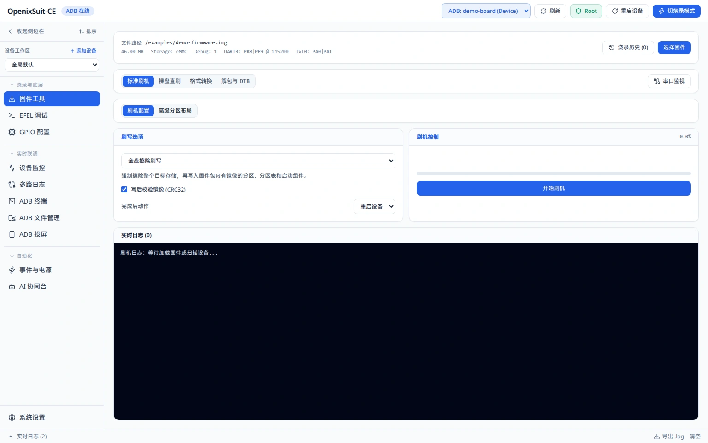</a></td>
    <td width="50%" valign="top"><strong>高级分区布局</strong><br>编辑分区扇区和大小，导出 MBR 或按自定义布局刷写。<br><a href="OpenixSuit-CE/screenshots/partition-layout.webp">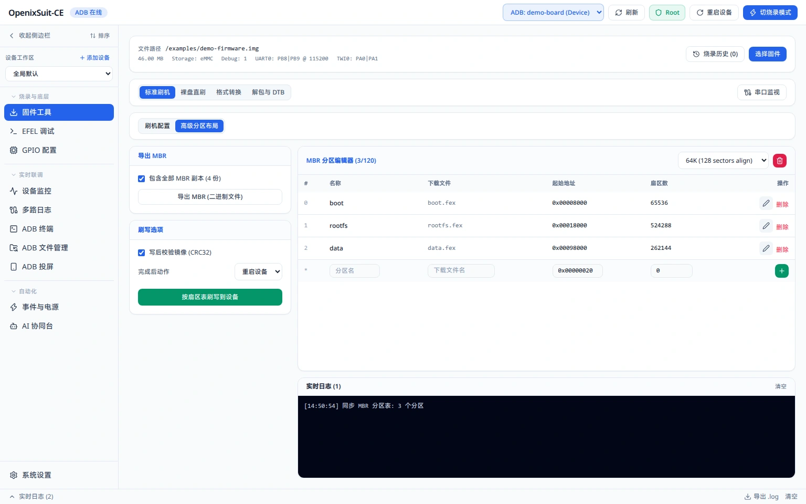</a></td>
  </tr>
  <tr>
    <td width="50%" valign="top"><strong>裸盘直刷</strong><br>指定引导固件、存储类型和偏移，直接写入原始镜像。<br><a href="OpenixSuit-CE/screenshots/raw-flash.webp">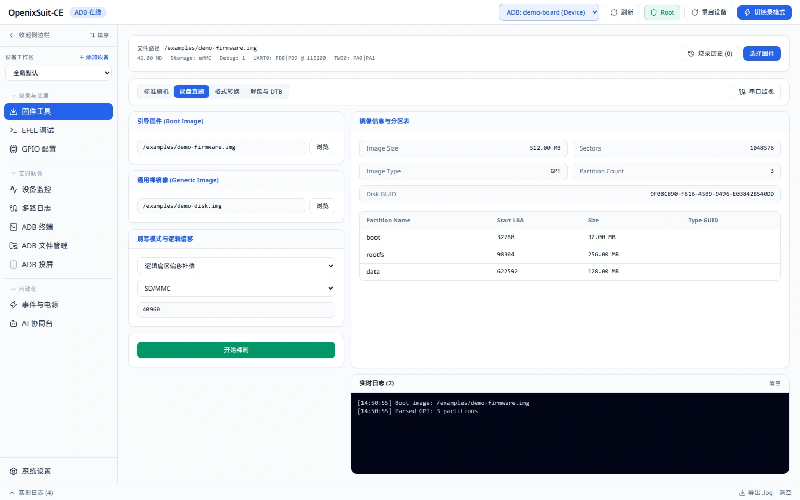</a></td>
    <td width="50%" valign="top"><strong>格式转换</strong><br>生成适用于 SPI NOR、SD、eMMC、SD NAND 或 UFS 的原始镜像。<br><a href="OpenixSuit-CE/screenshots/firmware-converter.webp">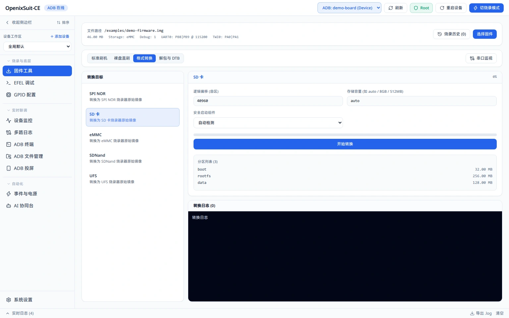</a></td>
  </tr>
  <tr>
    <td width="50%" valign="top"><strong>解包与 DTB</strong><br>查看和提取固件内容，将 DTB 反编译成 DTS。<br><a href="OpenixSuit-CE/screenshots/firmware-inspector.webp">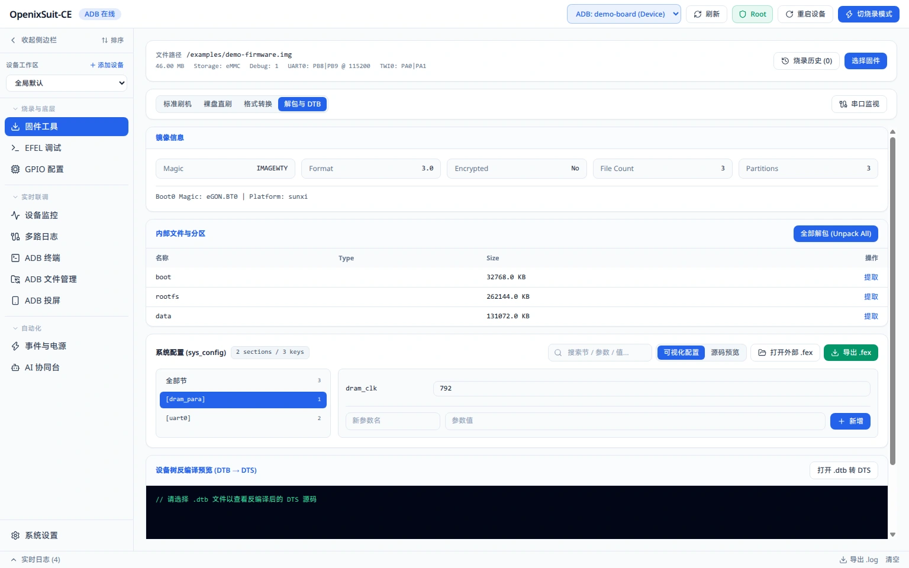</a></td>
    <td width="50%"></td>
  </tr>
</table>

### 设备联调

<table>
  <tr>
    <td width="50%" valign="top"><strong>EFEL 调试</strong><br>读写内存、查看反汇编、初始化 DRAM 或跳转执行。<br><a href="OpenixSuit-CE/screenshots/efel-debugger.webp">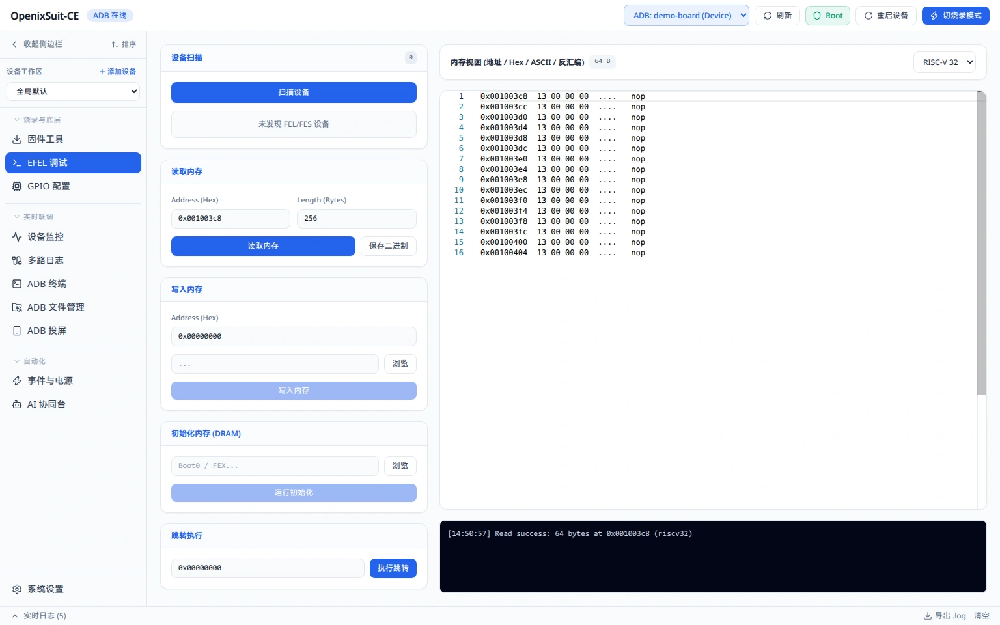</a></td>
    <td width="50%" valign="top"><strong>GPIO 配置</strong><br>通过 ADB 或 FEL 查看引脚状态与复用配置。<br><a href="OpenixSuit-CE/screenshots/gpio.webp">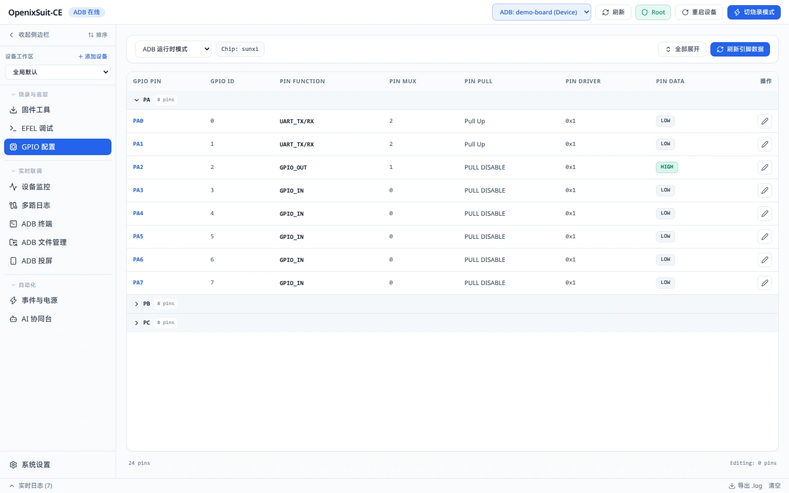</a></td>
  </tr>
  <tr>
    <td width="50%" valign="top"><strong>设备监控</strong><br>查看 CPU、内存、温度、网络、存储和进程。<br><a href="OpenixSuit-CE/screenshots/device-monitor.webp">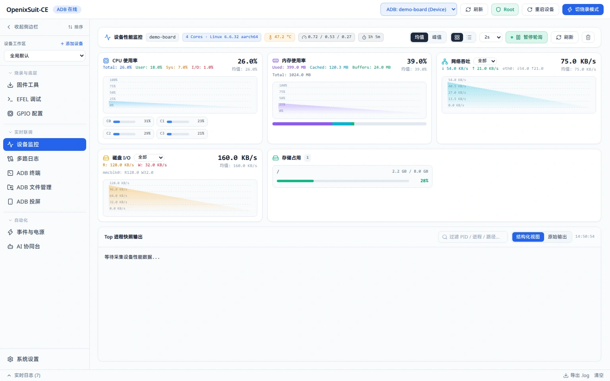</a></td>
    <td width="50%" valign="top"><strong>ADB 终端</strong><br>打开设备 Shell，执行命令并保存常用命令。<br><a href="OpenixSuit-CE/screenshots/adb-terminal.webp">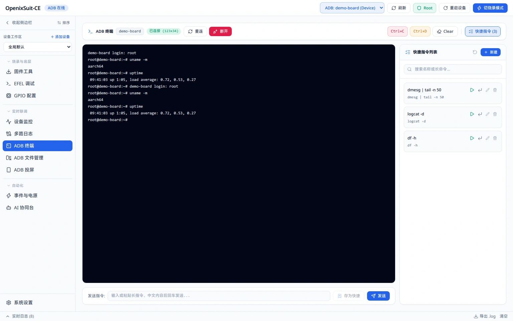</a></td>
  </tr>
  <tr>
    <td width="50%" valign="top"><strong>ADB 文件管理</strong><br>浏览、上传、下载和编辑设备文件。<br><a href="OpenixSuit-CE/screenshots/adb-files.webp">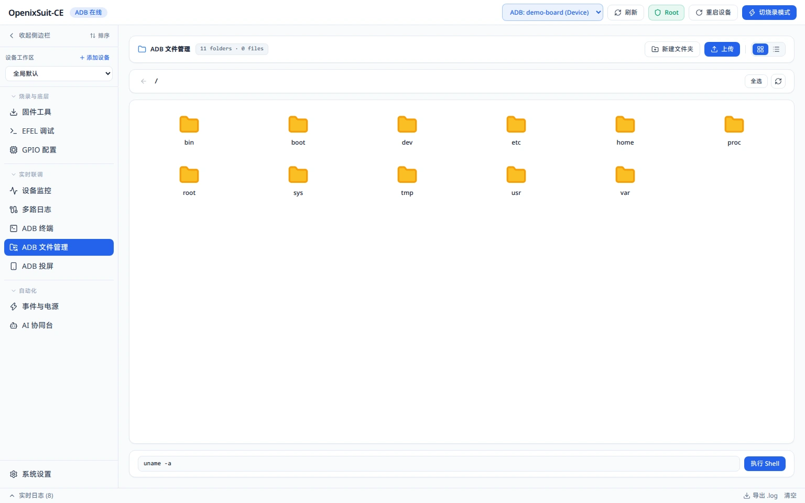</a></td>
    <td width="50%" valign="top"><strong>ADB 投屏</strong><br>查看设备画面并发送触控或按键。<br><a href="OpenixSuit-CE/screenshots/adb-screen.webp">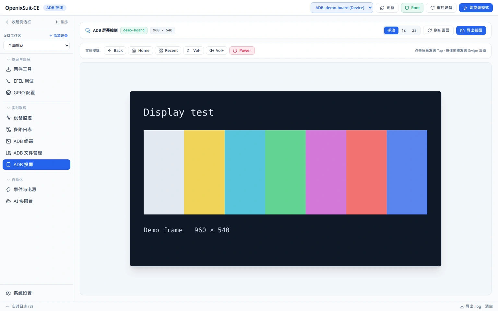</a></td>
  </tr>
</table>

### 多路日志

<table>
  <tr>
    <td width="50%" valign="top"><strong>实时分屏</strong><br>并排采集串口、USB CDC 和 ADB 命令日志，支持改名、放大和隐藏。<br><a href="OpenixSuit-CE/screenshots/live-logs.webp">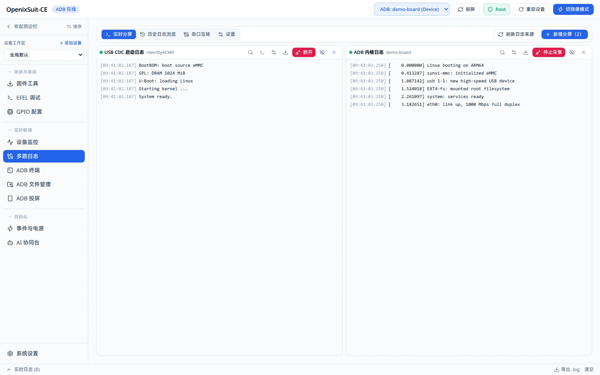</a></td>
    <td width="50%" valign="top"><strong>历史日志</strong><br>打开和搜索已保存的日志，查看文件位置。<br><a href="OpenixSuit-CE/screenshots/saved-logs.webp">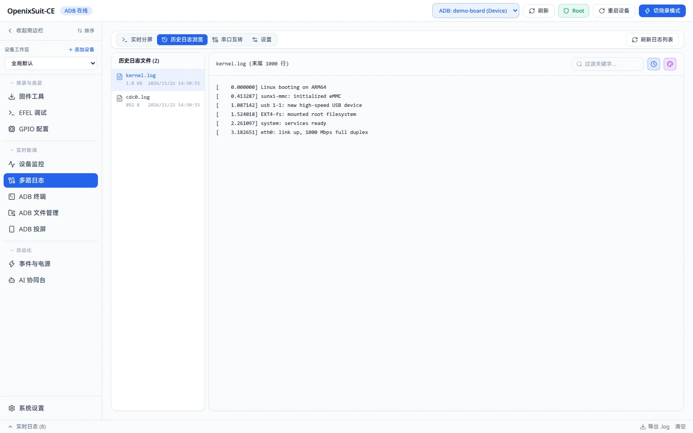</a></td>
  </tr>
  <tr>
    <td width="50%" valign="top"><strong>串口互转</strong><br>在两个串口间双向转发，按方向查看文本或十六进制数据。<br><a href="OpenixSuit-CE/screenshots/serial-bridge.webp">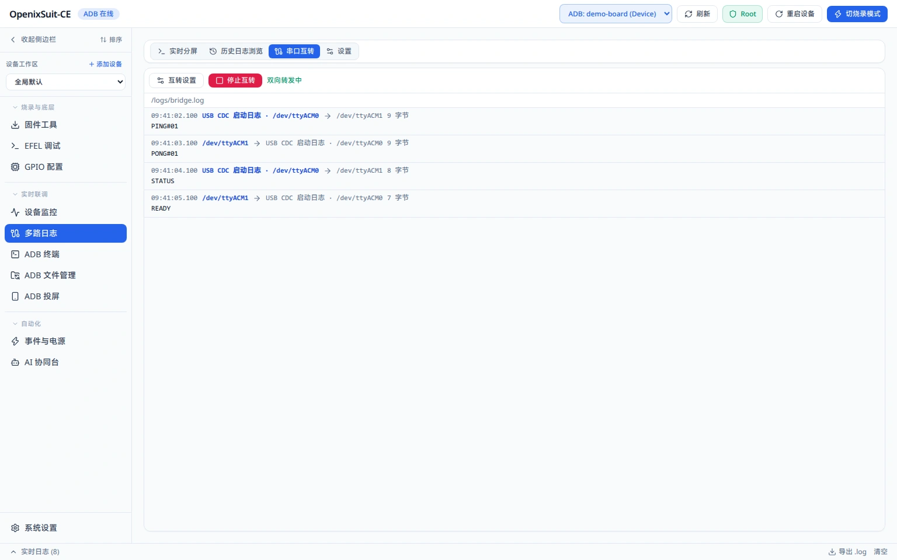</a></td>
    <td width="50%" valign="top"><strong>日志设置</strong><br>保存采集与互转配置，设置日志目录、连续保存和关键词前后文。<br><a href="OpenixSuit-CE/screenshots/log-settings.webp">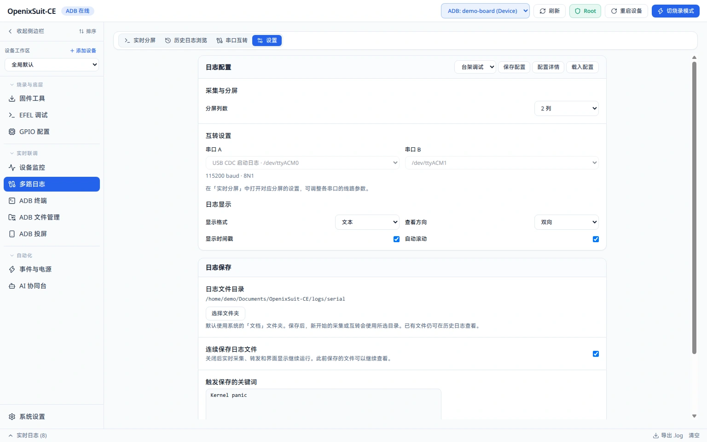</a></td>
  </tr>
</table>

退出前运行的采集和互转会在原设备就绪后恢复，手动停止的会话保持停止。

### 事件与电源

<table>
  <tr>
    <td width="50%" valign="top"><strong>事件规则</strong><br>匹配日志或超时后，发送 Webhook、交给 AI 分析或执行设备动作。<br><a href="OpenixSuit-CE/screenshots/event-rules.webp">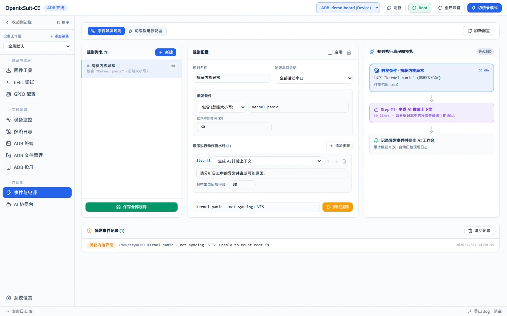</a></td>
    <td width="50%" valign="top"><strong>可编程电源</strong><br>用串口继电器、DTR／RTS、HTTP 或命令控制通断与重启。<br><a href="OpenixSuit-CE/screenshots/power.webp">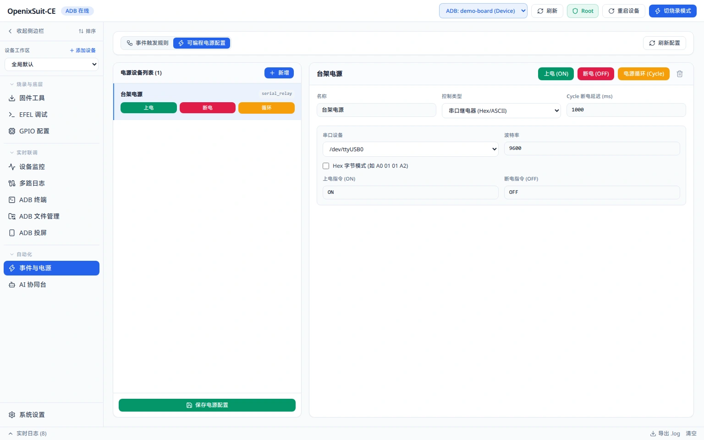</a></td>
  </tr>
</table>

### AI 与系统

<table>
  <tr>
    <td width="50%" valign="top"><strong>AI 协同台</strong><br>查看异常日志、分析结果和 AI 调用的同步记录。<br><a href="OpenixSuit-CE/screenshots/ai-workbench.webp">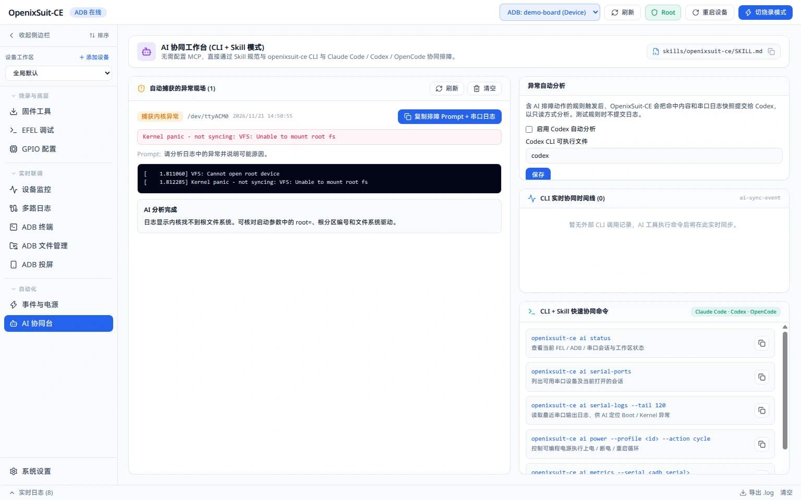</a></td>
    <td width="50%" valign="top"><strong>系统设置</strong><br>切换语言、主题和 USB 后端，管理扩展并检查更新。<br><a href="OpenixSuit-CE/screenshots/app-settings.webp">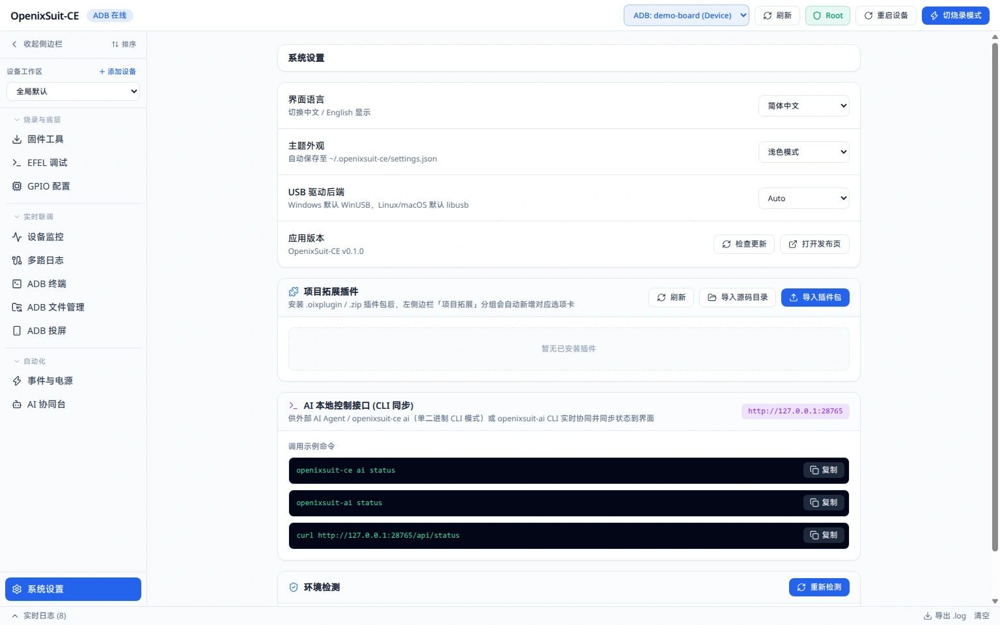</a></td>
  </tr>
</table>

通过 `openixsuit-ai` 配置采集、启停会话或保存规则。命令参数与 Webhook 接收端用法见 Skill。 [OpenixSuit-CE Skill](https://github.com/zhangwei43721/openixsuit-ce-skill)

## 从源码运行

准备 Rust、Node.js、npm、Tauri CLI 和对应平台的 Tauri 构建依赖后，在仓库根目录运行以下命令。

```bash
cd OpenixSuit-CE
npm ci
cargo tauri dev
```

执行 `cargo tauri build` 可打包桌面安装程序。需要在源码目录中一并使用 Skill 时，在仓库根目录执行 `git submodule update --init -- OpenixSuit-CE/skills/openixsuit-ce`。

## 构建与发布

- **测试安装包**。手动运行桌面端构建工作流，从运行页面的 **Artifacts** 下载。 [OpenixSuit-CE Build](https://github.com/zhangwei43721/OpenixSuit-CE/actions/workflows/openixsuit-ce.yml)
- **正式发版**。同步 `OpenixSuit-CE/package.json`、npm 锁文件、`src-tauri/Cargo.toml` 和 `src-tauri/tauri.conf.json` 的桌面版本，推送 `openixsuit-ce-v<版本>` 标签。工作流使用 Tauri 更新签名，生成安装包和更新清单，并上传到同一个 Release。
- **签名与更新**。在 GitHub Actions 配置仓库变量 `OPENIXSUIT_UPDATER_PUBLIC_KEY`、Secret `TAURI_SIGNING_PRIVATE_KEY`，私钥有密码时配置 `TAURI_SIGNING_PRIVATE_KEY_PASSWORD`。发布后可在「系统设置 → 应用版本」检查更新。私有仓库的安装包可登录 GitHub 后从发布页下载。 [Tauri 更新签名说明](https://v2.tauri.app/plugin/updater/#signing-updates)

## 许可证

项目使用 [MIT 许可证](LICENSE)。
